<p align="center">
  
</p>

# fynepdf-pdfa

**Turn PDFs into valid PDF/A by fixing them in place, not rebuilding them.** A C++17 library and
command line on [qpdf](https://github.com/qpdf/qpdf), MIT licensed, with no Ghostscript.
Made by [FynePDF](https://fynepdf.com) for its web and desktop apps.

- **Valid:** 99.3% of 2,053 test files come out valid PDF/A-2b, checked by
  [veraPDF](https://verapdf.org/) (Ghostscript: 93.5%, LibreOffice: 96.0%).
- **Honest:** a file it can't make PDF/A is never labelled PDF/A, and you're told why. The
  other tools mislabel 62 to 192 of the same files.
- **Keeps the document:** text, bookmarks, links, form fields, tags and layers stay as they
  were. Only what PDF/A forbids changes.
- **Missing fonts handled:** a font the PDF names without embedding gets a free stand-in with
  the same widths (Arial → Arimo, Times → Tinos, Calibri → Carlito, Cambria → Caladea, Chinese,
  Japanese and Korean too), so no line moves.
- **Light:** a typical file takes 0.01 s and 11 MB; the heaviest of 2,053 took 4.5 s and 215 MB.
- **PDF/A-1b, 2b and 3b.** PDF/A-1b pages that use transparency are drawn with
  [PDFium](https://pdfium.googlesource.com/pdfium/) when it's there, their text kept searchable.

## Results

PDF/A-2b on the same 2,053 files (the veraPDF corpus, 1,000 PDFs from the web, and files made to
test every PDF/A rule), each result checked by veraPDF 1.31:

| | Valid PDF/A | Labelled PDF/A but isn't | Text lost | Files that lost something | Total time | Most memory |
| --- | --- | --- | --- | --- | --- | --- |
| **fynepdf-pdfa** | **99.3%** | **0** | **1** | **22** | **96 s** | **215 MB** |
| Ghostscript 10.08 | 93.5% | 100 | 38 | 550 | 740 s | 1.4 GB |
| LibreOffice 25.2 | 96.0% | 62 | 90 | 1,359 | 4,113 s | 5.6 GB |
| OCRmyPDF 17.13 | 84.6% | 192 | 11 | 341 | 1,806 s | 5.2 GB |

"Lost" means bookmarks, links, form fields, tags, comments, attachments or signatures the input
had and the result doesn't. fynepdf-pdfa's 22 are comments and attachments PDF/A itself forbids;
it lost no bookmark, link, field or tag. Every tool, level and set, real files and how to run it
yourself: [docs/benchmarks.md](docs/benchmarks.md).

## Use it

### From the command line

```sh
npx fynepdf-pdfa input.pdf output.pdf             # PDF/A-2b
npx fynepdf-pdfa input.pdf output.pdf --part 1    # PDF/A-1b (or --part 3)
```

Through npm it runs on Linux (x64, arm64), Windows (x64) and macOS (Apple silicon, Intel), with
nothing to build. Or download your platform's archive from
[Releases](https://github.com/birazzzz/fynepdf-pdfa/releases): the program, its fonts and PDFium,
ready to run as `./fynepdf-pdfa input.pdf output.pdf`.

It prints what happened as one line of JSON and writes `output.pdf`:

```json
{"ok":true,"conforms":true,"pages":12,"signatures":0,"problems":[],"changes":{"cmyk-colours":31,"font-widths-written":2,"javascript":1}}
```

`conforms` is false when the file couldn't be made PDF/A. It is then written without the PDF/A
label, and `problems` say why (for example `font-not-embedded: KozMinPr6N-Regular`). Exit codes: 0 done, 2 needs a
password, 3 can't be read, 5 can't be written. The fonts are found beside the program or in the
install; `--fonts <folder>` points elsewhere.

### From Node

```js
const { toPdfa } = require("fynepdf-pdfa");   // npm install fynepdf-pdfa

const result = await toPdfa("in.pdf", "out.pdf", { part: 2 });
// result.conforms, result.problems, result.changes: the JSON above
```

It rejects when the file can't be read, needs a password or can't be written (`error.code`).
Types included; more in [npm/fynepdf-pdfa](npm/fynepdf-pdfa/README.md).

### From C++

```cpp
#include <fynepdf/pdfa/pdfa.h>

fynepdf::pdfa::PdfaOptions options;
options.part = 2;                    // PDF/A-1b, 2b or 3b
options.fonts = "path/to/fonts";     // this repository's fonts/ (installed: FYNEPDF_PDFA_FONTS_DIR)

fynepdf::pdfa::PdfaResult result = fynepdf::pdfa::ConvertToPdfa("in.pdf", "out.pdf", options);
if (result.ok && result.conforms) {
  // out.pdf is PDF/A-2b
} else {
  // result.error: "password", "unreadable", ...; result.problems: why it isn't PDF/A
}
```

[examples/convert.cpp](examples/convert.cpp) is a complete program.

### In your CMake project

```cmake
include(FetchContent)
FetchContent_Declare(fynepdf_pdfa GIT_REPOSITORY https://github.com/birazzzz/fynepdf-pdfa.git GIT_TAG v0.1.1)
FetchContent_MakeAvailable(fynepdf_pdfa)

target_link_libraries(your_app PRIVATE fynepdf::pdfa)
```

Or install it (`cmake --install build`) and use `find_package(fynepdf_pdfa CONFIG REQUIRED)`,
which also sets `FYNEPDF_PDFA_FONTS_DIR` to the installed fonts. It needs qpdf and a libjpeg
from your system or [vcpkg](https://vcpkg.io) (the repository has a `vcpkg.json`).

## Build it

You need CMake 3.16+, a C++17 compiler, qpdf 11 or newer and libjpeg-turbo. OpenJPEG (JPEG 2000
pictures), Little CMS (ICC profiles) and PDFium (PDF/A-1b transparency) are optional.

```sh
# Debian or Ubuntu
sudo apt install cmake ninja-build g++ pkg-config libqpdf-dev libjpeg-dev libopenjp2-7-dev liblcms2-dev
# macOS
brew install cmake ninja qpdf jpeg-turbo openjpeg little-cms2

cmake --preset default            # Release build with tests, into build/default
cmake --build --preset default
ctest --preset default            # converts the 64 test files at 1b, 2b and 3b
```

On Windows (or anywhere) with vcpkg: set `VCPKG_ROOT` and use `--preset vcpkg` instead. For
PDF/A-1b pages that use transparency, add `-DFYNEPDF_PDFA_PDFIUM_DIR=<folder>` with a
[pdfium-binaries](https://github.com/bblanchon/pdfium-binaries) release unpacked in it (PDFium is
loaded only when a page needs it). Add `-DFYNEPDF_PDFA_VERAPDF=docker` to check every test result
with veraPDF too.

The self-contained program the releases ship (its libraries linked in from vcpkg, PDFium and the
fonts beside it) comes from `node scripts/release-build.mjs <target>`, for `linux-x64`,
`linux-arm64`, `win32-x64`, `darwin-arm64` or `darwin-x64`; Linux targets build in Docker from any
machine. [RELEASING.md](RELEASING.md) has the rest.

Built and tested on Linux (Debian 12, GCC 12) and Windows (LLVM-MinGW, Clang 22). macOS and
Visual Studio builds are set up and covered by CI from the first release.

## How it works

It opens the PDF with qpdf and goes through it pass by pass: repair, catalog, colours, forms,
pages, layers, attachments, every object, content streams, fonts, text, transparency (PDF/A-1),
then the output intent and metadata. Each pass changes only what PDF/A forbids; the PDF/A label
goes on last, only if nothing is left. The fonts are most of the work: every font is read,
checked against the codes the pages show, fixed in place or replaced by a free font with the
same widths.

The full story, and what it doesn't do (the "a" and "u" levels, OCR, PDF/A-4):
[docs/how-it-works.md](docs/how-it-works.md).

## Why FynePDF built it

[FynePDF](https://fynepdf.com) used Ghostscript for PDF/A, like most tools do. It labelled files
PDF/A that weren't, lost bookmarks and text along the way, used a lot of the server, and its
AGPL licence ruled it out of our desktop app. We wanted PDF/A we could ship everywhere and trust,
so we wrote our own and measured it against everything else on the same files. This is it.

Sister project: [fynepdf-grayscale](https://github.com/birazzzz/fynepdf-grayscale), which makes
PDFs gray the same way, in place.

## Licence

MIT, © 2026 FynePDF. The fonts in `fonts/` keep their own licences (SIL OFL 1.1, Apache-2.0,
Bitstream Vera, BSD-3-Clause for Adobe's CMaps); see [THIRD-PARTY-NOTICES.md](THIRD-PARTY-NOTICES.md).
